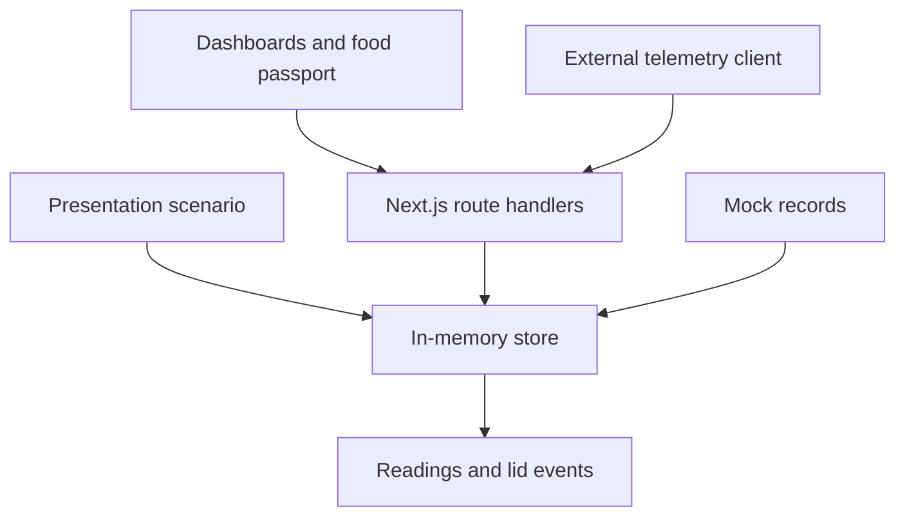

# FoodLink

A surplus-food redistribution web prototype connecting food providers, delivery partners and receiving organizations through dashboards, a digital food passport and a telemetry API.

[Open the demo](https://foodlink-flax.vercel.app)

## Problem and scope

Surplus-food handovers need visibility into batch origin, custody and container readings. FoodLink demonstrates those workflows using seeded records and a presentation scenario. It is an academic software prototype, not a food-safety certification system.

## Implementation status

| Area | Current implementation | Remaining work |
| --- | --- | --- |
| Web interface | Role dashboards, passport and device pages | Repeatable acceptance tests |
| Telemetry | GET/POST API; temperature, weight and lid processing | Device authentication, strict validation, physical sensor verification |
| Storage | Process-local global store with mock data | Durable database and migrations |
| Sign-in | Hardcoded demo users and client-side sessions | Server-verified sessions and API permissions |
| Hardware | Device specifications and JSON ingestion interface | Firmware, wiring, calibration evidence and prototype photos |
| Presentation | Ten-stage simulated batch journey | Distinguish simulation from physical measurements |

## Features and stack

Role-specific dashboards, batch creation, a public food passport, a device registry, telemetry history, alert calculations, lid events and presentation mode for FL-DEMO-001.

Next.js 16.3.5, React 19, TypeScript, Tailwind CSS 4 and Lucide icons. The backend uses Next.js App Router route handlers.

## Architecture



The client arrow describes the HTTP interface, not verified ESP32 operation. State is local to a server process and can reset on restart or differ across serverless instances.

## Installation

Use Node.js 22 LTS and npm as a setup target; verify a clean build in your environment.

```bash
git clone https://github.com/kanisk-sk/FoodLink.git
cd FoodLink
npm ci
npm run dev
```

Open http://localhost:3000. Validation commands:

```bash
npm run lint
npx tsc --noEmit
npm run build
npm run start
```

No automated test script is defined in package.json. These are verification instructions, not a claim that checks have passed.

### Demo accounts

| Role | Email | Password |
| --- | --- | --- |
| Provider | provider@foodlink.demo | FoodLink123 |
| Delivery | delivery@foodlink.demo | FoodLink123 |
| Receiver | receiver@foodlink.demo | FoodLink123 |

These public credentials live in src/lib/auth.ts. Client-side roles and localStorage/cookies are not a security boundary. Use fictional data only.

### Environment

The inspected demo authentication and telemetry store require no API key or database credentials. Document new configuration in a secret-free .env.example when adding persistent storage or real authentication.

## Routes and API

| Route | Purpose |
| --- | --- |
| /login | Demo sign-in |
| /app?role=provider | Provider dashboard |
| /app?role=delivery | Delivery dashboard |
| /app?role=receiver | Receiver dashboard |
| /food/[batchId] | Food passport |
| /devices | Device registry |
| /presentation | Simulated journey |
| GET /api/batches | List batches |
| POST /api/batches | Create batch |
| GET /api/devices | Device data |
| GET /api/devices/[deviceId]/telemetry | Read telemetry; optional batchId query |
| POST /api/devices/[deviceId]/telemetry | Record telemetry |
| GET /api/demo | Read scenario |
| POST /api/demo | Change scenario |

### Local telemetry example

```bash
curl -X POST http://localhost:3000/api/devices/FL-NODE-001/telemetry -H 'Content-Type: application/json' -d '{"batchId":"FL-DEMO-001","temperature":62.4,"weight":6.4,"lidOpen":false,"isDemo":true}'
```

The handler requires batchId, temperature, weight and lidOpen. Success returns status ACK, telemetry, any new lid event and alert flags. Weight is gross kilograms; the store subtracts a fixed 2.20 kg tare. Temperature is treated as Celsius.

## Data model

The store holds devices, batches, telemetryLogs, lidEvents and demoCurrentStep. Readings and lid events reference batchId and deviceId. There are no database migrations or enforced foreign keys.

## Known limitations

- Telemetry has no device authentication. Required-field checks and type coercion do not provide comprehensive validation.
- Demo sign-in does not establish server-enforced role permissions.
- Records are mutable and non-durable; the passport is not an immutable audit ledger.
- Some seeded readings use isDemo: false despite being fixtures. That flag is not proof of sensor origin.
- Temperature alerts use fixed thresholds below 50 or above 75 degrees, regardless of food category. They must not determine food safety.
- Weight alerts use a fixed 2.20 kg tare and a 0.25 kg variance threshold rather than container-specific calibration.
- Physical ESP32 integration, calibration and end-to-end operation remain unverified by this code review.
- Actual dashboard screenshots and hardware photographs still need to be added.

## Future improvements

1. Add server authentication, role permissions and device credentials.
2. Validate finite numeric ranges, booleans, timestamps and device/batch ownership.
3. Add persistent storage, migrations and workflow tests.
4. Separate fixtures from physical readings and display their source.
5. Publish firmware, wiring and calibration procedures.
6. Capture actual dashboard screenshots and prototype photos after verification.

## Licence

No LICENSE file is currently included. The earlier MIT link pointed to a missing file. Select and add a licence after confirming ownership of code and assets.
